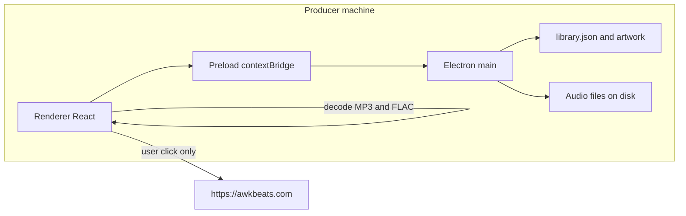

# Technical requirements — AwkBeats Prep Station

## Document control

| Field | Value |
| --- | --- |
| Project | AwkBeats Prep Station |
| Document title | Technical Requirements Document |
| Document ID | ABP-TRD |
| Version | 1.1 |
| Status | Final (as shipped) |
| Last updated | 2026-10-21 (UTC) |
| Author | Cursor Agent, for owner Awkward J |
| Repo | https://github.com/Awkward8787/awkbeats-prep-station |
| Branch | `cursor/awkbeats-prep-station-e2e2` |
| Commit SHA | f99d3c6a38ad256e123fa13b50e0f7660369bd61 |
| Live URL | None. Desktop app. Brand site: https://awkbeats.com |
| Operator | Awkward J (legal entity UNCONFIRMED) |

## Table of contents

1. Architecture
2. Tech stack
3. Repository structure
4. Environments
5. Configuration and secrets
6. Third-party integrations
7. Security
8. Privacy
9. Performance
10. Accessibility
11. SEO
12. Build and deploy
13. Testing
14. Monitoring
15. Browser and device support
16. Technical debt
17. Glossary
18. Open questions
19. Changelog
20. Sources

## 1. Architecture

The app is a single Electron process plus one sandboxed renderer. There is no application server.



Caption: Process split. The renderer never reads the filesystem directly. The main process owns the library and the tag writer.

A request (an IPC call) flows like this. The renderer calls `window.prep`, which is the object exposed by `electron/preload.ts`. The preload uses `ipcRenderer.invoke` with a fixed channel name. `electron/main.ts` handles that channel, calls a class in `src/core`, and returns JSON-serializable data. Audio bytes for MP3 and FLAC analysis travel back to the renderer because Chromium already contains those decoders. WAV and AIFF are decoded in the main process with `PcmDecoder`.

The `beat://` scheme is registered as privileged before `app.ready`. `beat://audio/<id>` and `beat://cover/<id>` are handled with `net.fetch(pathToFileURL(...))` so the renderer can play audio and show art without a raw `file://` path in the page.

## 2. Tech stack

Versions are the ones installed for the 1.0.0 lockfile.

| Layer | Technology | Version | Why | Alternatives rejected |
| --- | --- | --- | --- | --- |
| Language | TypeScript | 5.9.3 | Shared types between main and renderer | Plain JS |
| Desktop shell | Electron | 33.4.11 | Mature installers, Chromium decoders for MP3/FLAC | Tauri (no Chromium decoder; would need another permissive decoder) |
| UI | React | 18.3.1 | Component model for the three-pane window | No router; one window |
| Styling | CSS file | `src/renderer/styles.css` | Small surface, no utility framework | Tailwind not needed |
| Fonts | IBM Plex Sans and Mono via fontsource | 5.2.x | OFL, self-hosted | System fonts only would drift between macOS and Windows |
| Renderer build | Vite | 6.4.5 | Fast dev server | webpack |
| Main and preload build | esbuild | 0.24.2 | Bundle CJS, externalize electron and music-metadata | tsc emit |
| Test | Vitest | 2.1.9 | Same TS path aliases | Jest |
| Package | electron-builder | 25.1.8 | dmg and NSIS | Manual zip |
| Tags write | node-id3 | 0.2.9 | MIT ID3v2 writer | Any GPL tagger |
| Tags read | music-metadata | 7.14.0 | MIT, CJS | — |
| Key and BPM | Original TypeScript | — | Permissive, testable | essentia.js (AGPL), aubio (GPL) |
| Catalog | JSON file | schema version 1 | No native module | SQLite / sql.js (wasm packaging deferred) |
| CI | GitHub Actions | checkout/setup-node/upload-artifact v4 | macOS and Windows runners | Local cross-compile |

Node in CI is 22. The development machine that produced this tree used Node 22.23.3 and npm 10.9.9.

State management is React `useState` in `src/renderer/App.tsx`. There is no Redux or router.

Linting: `tsc --noEmit` is the type gate. There is no ESLint config in v1.

## 3. Repository structure

```
electron/main.ts          window, menu, IPC, beat:// protocol
electron/preload.ts       PrepApi bridge
src/core/analysis/        Fft, BpmDetector, KeyDetector, Camelot, BpmMath, TrackAnalyzer
src/core/audio/           PcmDecoder, ReferenceAudio (tests and generators)
src/core/library/         LibraryStore, Importer, BeatRules, CsvExport, SquareCrop, types
src/core/tags/            TagReader, TagWriter, TagCommit, TagTypes
src/renderer/             React UI, styles, index.html CSP
tests/                    bpm-key and library-tags
tests/fixtures/silence.flac
scripts/dev.mjs           Vite + esbuild watch + Electron
scripts/check-licenses.mjs
scripts/seed-demo.ts      local demo library, not shipped in the installer
build/icon.png, logo.png, icon.ico, icon.icns, icons/
electron-builder.yml
.github/workflows/installers.yml
docs/                     this documentation set
```

`dist/` and `release/` are build outputs and are gitignored.

## 4. Environments

| Environment | URL | How it runs | Difference |
| --- | --- | --- | --- |
| Local dev | `http://localhost:5173` inside Electron, set as `VITE_DEV_SERVER_URL` | `npm run dev` | Vite HMR. CSP allows that origin. |
| Local production build | `file://` to `dist/renderer/index.html` | `npm run build && npm start` | No dev server. |
| Installer | none until the owner distributes the artifact | `npm run dist:mac` or `dist:win`, or CI | asar archive. Unsigned. |
| Staging | Not applicable | No staging host | — |
| Hosted production | Not applicable | The app does not deploy to a server | — |

`AWKBEATS_USER_DATA` points the library at a chosen folder. Unset, Electron uses its default userData path for app id `com.awkbeats.prepstation`.

## 5. Configuration and secrets

No secret is required to build or run the unsigned app. Signing secrets are owner-supplied later and must never be committed.

| Name | Purpose | Required | Default | Where set | Where read | Rotation |
| --- | --- | --- | --- | --- | --- | --- |
| `AWKBEATS_USER_DATA` | Override library directory | Optional | Electron userData | Process environment | `electron/main.ts` before ready | Change the path; move `library.json` and `artwork/` together |
| `VITE_DEV_SERVER_URL` | Dev renderer origin | Dev only | Unset in production | `scripts/dev.mjs` | `electron/main.ts` `createWindow` | Restart dev |
| `CSC_LINK` | Base64 Apple or Windows signing cert | Optional, signing only | Unset | GitHub Actions secret | electron-builder, not application code | Revoke the cert with the vendor, replace the secret |
| `CSC_KEY_PASSWORD` | Password for `CSC_LINK` | With `CSC_LINK` | Unset | GitHub Actions secret | electron-builder | Same as the cert |
| `WIN_CSC_LINK` / `WIN_CSC_KEY_PASSWORD` | Windows-specific override | Optional | Unset | GitHub Actions secret | electron-builder | Same |
| `APPLE_API_KEY`, `APPLE_API_KEY_ID`, `APPLE_API_ISSUER`, `APPLE_TEAM_ID` | Notarization | Optional | Unset | GitHub Actions secret | electron-builder notarize | Rotate the API key in App Store Connect |
| `CSC_IDENTITY_AUTO_DISCOVERY` | Stop the builder from grabbing a random local cert | Set to `false` in CI | false in the workflow | `.github/workflows/installers.yml` | electron-builder | Leave false until a signing job exists |
| `GITHUB_TOKEN` | Default Actions token | Present on Actions | — | GitHub | Not read by app code. `publish: null` and `--publish never` keep electron-builder from publishing. `.github/workflows/release.yml` uses the token only to attach installers to a `v*` Release | GitHub rotates it |

There is no `.env` file. Do not add signing material to one.

## 6. Third-party integrations

No payment, email, auth, analytics, storage, CDN, or AI API is called.

| Integration | Account | Endpoints | Auth | Failure |
| --- | --- | --- | --- | --- |
| awkbeats.com | The owner's site. Account ID UNCONFIRMED. | `https://awkbeats.com` via `shell.openExternal` when the brand control is activated | None | OS browser handles failure. The library still works. |
| GitHub Actions | Repo Awkward8787/awkbeats-prep-station | Workflow artifacts on branch pushes. GitHub Releases on `v*` tags | Branch workflow `contents: read`. Release workflow `contents: write` | Installer job fails if `release/*.dmg` or `release/*.exe` is missing |
| music-metadata, node-id3 | npm packages, not accounts | Local function calls | None | Tag read/write throws; UI shows the tag-failed message or the import failure count |

Sandbox versus production: not applicable. There is one build.

## 7. Security

Authentication: none. The person at the keyboard is the user. The library is as private as the OS user account.

Authorization: IPC channels are a fixed list in `electron/preload.ts`. The renderer cannot pass a channel name of its own choosing through the bridge. Paths come from the file dialog or from `webUtils.getPathForFile` on a dropped file.

Input validation (`BeatValidation`):

- ISRC: empty, or `/^[A-Z]{2}[A-Z0-9]{3}\d{7}$/` after removing hyphens and spaces and uppercasing. Stored canonical, 12 characters.
- BPM override: 40 through 300 inclusive (`BpmMath.inRange`).
- Tags: trim, collapse whitespace, case-insensitive de-dupe, max 24 tags, 32 characters each.
- Status: one of `idea`, `in_progress`, `ready`, `leased`, `sold`.
- Comment max 4000 characters. Copyright max 400.
- Audio import: extension allow-list, size greater than 0 and at most 2 GiB, skip dotfiles.
- Cover export size: 1500 or 3000 only.

CSRF and CORS: not applicable to a local window. The `beat` scheme sets `corsEnabled` so the renderer can fetch it. Navigation: `setWindowOpenHandler` returns deny. `will-navigate` allows only the dev server origin and `file:`.

Rate limiting: not applicable. There is no public endpoint.

CSP in `src/renderer/index.html`:

```
default-src 'self' beat:;
script-src 'self';
style-src 'self' 'unsafe-inline';
img-src 'self' data: blob: beat:;
media-src 'self' blob: beat:;
connect-src 'self' beat: http://localhost:5173 ws://localhost:5173;
```

`style-src 'unsafe-inline'` is there because the cover well sets a background image in an element style and the crop stage positions an image with inline coordinates. There is no HSTS header because the document is not served over HTTPS. The brand site is opened in the system browser.

Secret storage: none in the app. Dependency audit: `npm run licenses` fails on GPL-family licenses in production packages. That check passed on the 1.0.0 tree. File permissions: the library directory inherits the user's umask. Known accepted risk: an unsigned binary will be flagged by Gatekeeper and SmartScreen. Another accepted risk: `connect-src` includes localhost so the dev build can load Vite. The production window does not start a server, but the CSP text is the same HTML file.

## 8. Privacy

| Data | Where | Retention | Third party |
| --- | --- | --- | --- |
| Audio the producer imports | Original path on disk. The app does not copy the audio into userData. | Until the producer deletes the file | None |
| Catalog | `library.json` in userData | Until the producer removes beats or deletes the folder | None |
| Cover JPEGs | `userData/artwork/<id>.jpg` | Deleted when the beat is removed from the library | None |
| Cookies, localStorage, IndexedDB | Not used | — | — |

`library.json` can contain file paths, which may include the OS username. That file stays on the machine. The app does not ship a logger that uploads.

## 9. Performance

Production renderer build measured on this tree:

| Asset | Size |
| --- | --- |
| `dist/renderer/assets/index-*.js` | 190.62 kB (Vite, gzip 61.32 kB) |
| `dist/renderer/assets/index-*.css` | 16.59 kB (Vite, gzip 3.64 kB) |
| IBM Plex woff2 subsets | about 8–16 KB each, weights imported: sans 400/500/600, mono 500 |
| `dist/main/index.js` | 668 KB (node-id3 bundled; music-metadata external) |
| `dist/preload/index.js` | 4 KB |

Code splitting: one renderer chunk. The window is one screen. Caching headers: not applicable (file load). Images: covers are JPEG written by the crop dialog at quality 0.92, or the original sidecar bytes. Fonts are self-hosted woff2. No CDN.

Analysis reads at most the first 90 seconds. Onset detection uses hop 32. Key detection uses FFT size 16384 and hop 8192. The waveform stored on the beat is 160 peaks, each 0–1 with three decimal places.

## 10. Accessibility

- The search field has a label ("Search the library") that is visually clipped with the `.sr` class and tied to `library-search`. Other fields have visible labels.
- Focus: `:focus-visible` is a 2px solid `#f3d7a4` ring, 2px offset.
- Keyboard: listed in `ShortcutsDialog` and implemented in `App.tsx`. Status keys 1–5 map onto `BEAT_STATUSES` order. Shortcuts do not fire while an input, textarea, or select is focused, except Escape closes a dialog.
- Dialogs close with Escape, Cancel, or Close. Opening a dialog focuses the first field or the Cancel button, traps Tab inside the dialog, and returns focus to the opener.
- Contrast: see ABP-DESIGN. Body text `#f7f2fb` on `#140b1f` is 17.36:1. The faintest label, `#a896c2` on the selected row `#3a2260`, is 4.95:1. Control borders `#7d68a0` on `#24163a` are 3.49:1. Text on gold is `#1f1405` on `#e4b15a`, 9.25:1.
- Reduced motion: all transitions and animations are disabled.
- The play button is 36×36 CSS pixels. Table rows are 44px tall. Filter rows are about 32px, under a 44px target. Noted as debt.
- Color is not the only status signal. The status word is also printed.
- There is no skip link. The window has no repeated web header to skip.

## 11. SEO and sharing

Not applicable. The app has no public routes, sitemap, robots.txt, canonical URL, or Open Graph tags. The HTML title is "AwkBeats Prep Station". The installer icons are `build/icon.png` (1024) and `build/icon.ico`.

## 12. Build and deploy

Commands:

```bash
npm ci
npm test
npm run typecheck
npm run licenses
npm run build
```

`npm run build` runs esbuild for `electron/main.ts` and `electron/preload.ts` (CJS, electron external, music-metadata external on main) and `vite build` with root `src/renderer`, `base: './'`, outDir `dist/renderer`.

Installers:

```bash
npm run dist:mac
npm run dist:win
```

Both pass `--publish never`. CI (`.github/workflows/installers.yml`) runs test, typecheck, and licenses on `ubuntu-latest`, then `dist:mac` on `macos-latest` and `dist:win` on `windows-latest`. Artifacts:

- `AwkBeats-Prep-Station-macOS` from `release/*.dmg`
- `AwkBeats-Prep-Station-Windows` from `release/*.exe`

`if-no-files-found: error`. Permissions are `contents: read`. `publish: null` in `electron-builder.yml`.

A push of a tag matching `v*` runs `.github/workflows/release.yml` instead of the branch artifact workflow. It builds the same unsigned installers (`dist:mac` is still arm64, then x64) and attaches the two disk images and the NSIS exe to that tag's GitHub Release with `softprops/action-gh-release`. The token is `GITHUB_TOKEN` with `contents: write`. No signing secrets are set. The notes file is `.github/release-notes.md`. The workflow refuses to create a tag; the tag must already exist.

There is no cache to purge and no server to roll back. Rollback of an installed copy is the OS uninstall plus installing the previous artifact. Rollback of the repo is `git revert`.

Post-build check: `release/` contains the dmg or exe; the app launches; the unit tests still match known tempos.

## 13. Testing

Framework: Vitest 2.1.9, `vitest.config.ts`, timeout 30 seconds, alias `@core` to `src/core`.

`tests/bpm-key.test.ts` asserts:

- FFT magnitude peak location.
- Camelot parse and format, including F# minor = 11A and flats mapping onto sharps.
- `BpmMath` half, double, range, and working tempo.
- Click tracks at 72.5, 90, 96, 120, 128.05, 140.25, 150, and 174 BPM, each within 0.01.
- Noise bursts at 100 BPM within 0.01.
- Soft pulses at 110 BPM within 0.01 and confidence greater than 0.8.
- An 80 BPM click is not reported as 160.
- All 12 major and 12 minor keys on `ReferenceAudio.keyedTone`.
- A drum loop at 96 BPM in F# minor returns 96.00 and `11A`.

`tests/library-tags.test.ts` asserts PCM round-trip error under 1/30000; MP3, WAV, AIFF, and FLAC tag round-trip including decimal BPM, Camelot, tags, ISRC, and artwork; WAV audio samples unchanged after a tag rewrite; import, duplicate skip, lock surviving re-analysis, filters, CSV, ISRC validation, crop math, and batch status.

Run: `npm test`. CI status: the workflow file is in the repo. The run URL is the Actions run for the shipping commit (see ABP-PLAN).

Manual QA: launch, import, read key and BPM, edit metadata, open crop at 3000, write tags, export CSV. Screenshots of the library, the analysis card, the metadata editor, and the crop dialog were taken on a Linux Electron window during development. macOS and Windows GUI launch is not part of the workflow. The runners prove the installer files exist.

Known gaps: no automated UI test. No test that Chromium's MP3 decoder matches a fixture BPM. The detector itself is tested on PCM. No installer GUI test on this Linux tree.

## 14. Monitoring and logging

Electron and Chromium write their default stderr. The app does not log file contents, ISRC lists, or keystrokes to a server. A packaged app's logs stay in the OS console. Alerts and uptime checks are not applicable. There is no service to ping.

## 15. Browser and device support

| Target | Support |
| --- | --- |
| macOS arm64 and x64 | dmg via electron-builder. Exact minimum macOS is whatever Electron 33.4.11 declares (UNCONFIRMED as a marketing string). |
| Windows x64 | NSIS exe. Per-user install, directory changeable, not one-click. |
| Windows arm64, Linux packages | Not built |
| Web browsers | Not a target. The renderer is Chromium inside Electron 33. |
| Phone | Not a target. The window minimum is 1100×700. At 1359px and below, the genre column hides and the workspace columns are 216px, flexible, and 340px. |

## 16. Technical debt and known issues

| Item | Severity | Proposed fix |
| --- | --- | --- |
| Unsigned installers | High for distribution | Owner certificates, then a signing job. |
| Dialog focus trap | Resolved | `dialogs.tsx` traps Tab, sets initial focus, and restores the opener. |
| Some hit targets under 44px | Low | Increase `.status-item` padding if an audit requires a 44px target. |
| `style-src 'unsafe-inline'` | Low | Move cover and crop positioning to CSS variables set from classes. |
| Catalog is one JSON rewrite per edit | Low until thousands of beats | Migrate to SQLite with the same `Beat` fields. |
| music-metadata parses BPM as an integer | Low, already handled | `TagReader.readNative` keeps the decimal. Do not remove that path. |
| Half-time of a mix without a clear kick can still be the tempo the producer wants | Medium, product | The UI offers half, double, and a typed BPM. |
| `concurrently` and `wait-on` are unused devDependencies | Low | Remove on a later cleanup. |
| React and fontsource are production dependencies even though Vite bundles them | Low | Move to devDependencies to slim the asar. music-metadata must stay a production dependency. node-id3 is bundled into the main file. |
| Search label is screen-reader only | Low | The field is the only text input in the top bar. Add a visible label if a later audit wants it. |

## 17. Glossary

| Term | Meaning |
| --- | --- |
| IPC | Electron `ipcMain.handle` / `ipcRenderer.invoke` channels listed in ABP-DATA. |
| asar | Electron archive of `dist/**` and `package.json`. |
| NSIS | The Windows installer technology electron-builder uses. |
| PrepApi | The TypeScript type of `window.prep` in `electron/preload.ts`. |

## 18. Open questions

| ID | Question | Owner | Blocked |
| --- | --- | --- | --- |
| Q-001 | Legal entity for the Developer ID certificate | Awkward J | Signed macOS build |
| Q-007 | Which Windows certificate vendor, OV or EV? | Awkward J | SmartScreen reputation. EV is the one that trusts immediately. |
| Q-008 | Confirm Electron's declared minimum macOS for the 33.4.11 binary before publishing a support line | Awkward J | Support page, which does not exist yet |

## 19. Changelog

| Date | Version | Change | Why |
| --- | --- | --- | --- |
| 2026-10-21 | 1.0 | Initial TRD for the 1.0.0 Electron tree. | Owner build brief. Muted text color raised to `#938d85` so small labels meet WCAG AA. |
| 2026-10-21 | 1.1 | Installer icons are `build/icon.icns`, `build/icon.ico`, and `build/icons/`. | Owner supplied the iOS icon. |

## 20. Sources

- `package.json`, installed versions listed in section 2.
- `electron/main.ts`, `electron/preload.ts`, `electron-builder.yml`.
- `src/renderer/index.html`, `vite.config.ts`, `vitest.config.ts`, `tsconfig.json`.
- `.github/workflows/installers.yml`, `scripts/check-licenses.mjs`, `scripts/dev.mjs`.
- `tests/bpm-key.test.ts`, `tests/library-tags.test.ts`.
- Bundle sizes from `du` on `dist/` after `npm run build` on 2026-10-21.
