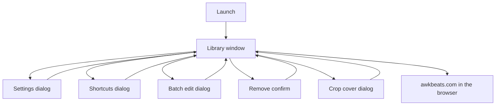
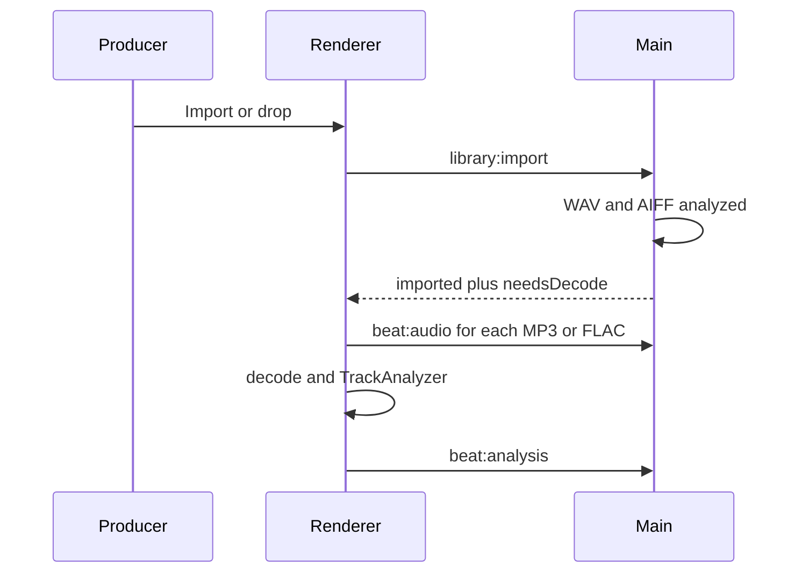
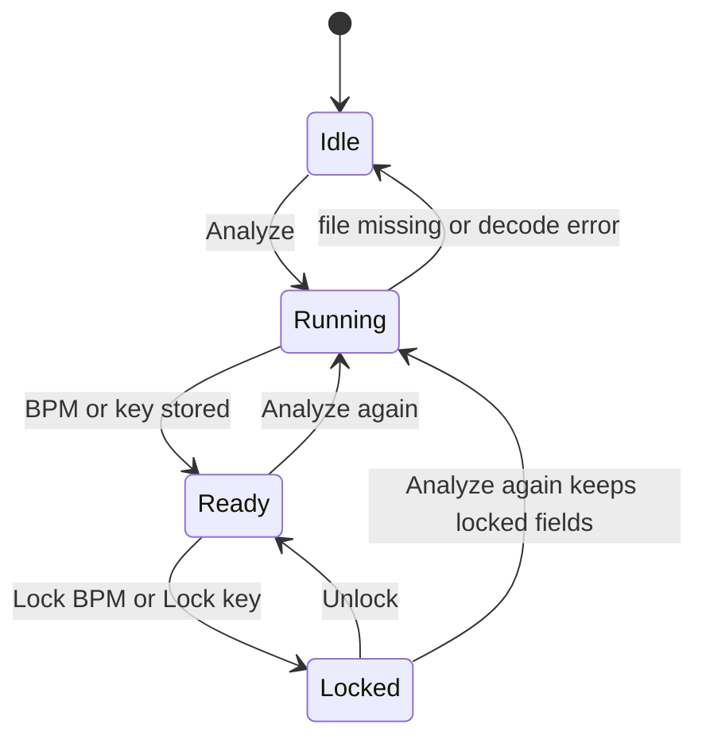
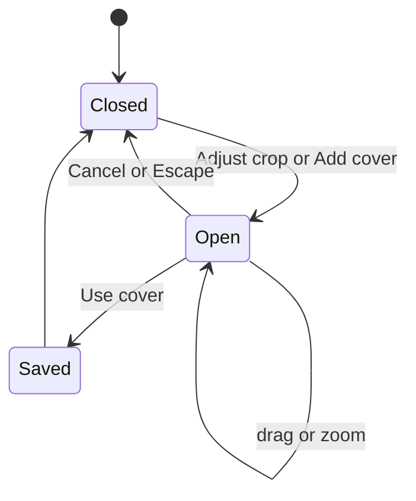

# App flow — AwkBeats Prep Station

## Document control

| Field | Value |
| --- | --- |
| Project | AwkBeats Prep Station |
| Document title | App Flow |
| Document ID | ABP-FLOW |
| Version | 1.0 |
| Status | Final (as shipped) |
| Last updated | 2026-10-21 (UTC) |
| Author | Cursor Agent, for owner Awkward J |
| Repo | https://github.com/Awkward8787/awkbeats-prep-station |
| Branch | `cursor/awkbeats-prep-station-e2e2` |
| Commit SHA | Recorded in the changelog of the shipping commit that contains this file |
| Live URL | None. One desktop window. Brand site: https://awkbeats.com |
| Operator | Awkward J (legal entity UNCONFIRMED) |

## Table of contents

1. Screen inventory
2. Navigation
3. Sitemap diagram
4. User journeys
5. Feature flows
6. Payment
7. Error, empty, and edge states
8. Messages
9. Screenshots
10. Glossary
11. Open questions
12. Changelog
13. Sources

## 1. Screen inventory

There is no URL router. Screens are the main window plus dialogs. Auth is never required.

| Screen | Path | Purpose | Entry | Exit | Component |
| --- | --- | --- | --- | --- | --- |
| Library | window | List, filter, inspect the selected beat | Launch | Quit | `src/renderer/App.tsx` |
| Settings | dialog | Producer name, copyright template, default export size | Settings button, Ctrl/⌘ comma, macOS app menu | Save settings or Cancel | `dialogs.tsx` `SettingsDialog` |
| Shortcuts | dialog | Shortcut list | Shortcuts button, Ctrl/⌘ / | Close or Escape | `ShortcutsDialog` |
| Batch edit | dialog | Apply status, genre, mood, artist, tags, copyright to the selection | Batch edit in the inspector | Apply or Cancel | `BatchDialog` |
| Remove confirm | dialog | Confirm removal from the library | Remove, or Ctrl/⌘ Backspace | Remove or Cancel | `ConfirmDialog` |
| Crop cover | dialog | Square crop and export size | Adjust crop | Use cover or Cancel | `CropDialog` |
| awkbeats.com | external browser | Brand site | Brand button | OS browser | `shell.openExternal` |

Below 980px CSS width, the rail hides while a beat is selected (class `app.inspecting`) and the inspector hides when nothing is selected. The default window is 1440×920, so all three columns show.

## 2. Navigation

The top bar holds the brand button, the search field, Import, and the count of selected rows. The left rail holds status filters, genre, key, tag, BPM range, and dates. The center is the table. The right inspector is the selected beat. The footer holds the visible count, Shortcuts, and Settings.

The application menu (File, Edit, Library, Help) mirrors import, CSV, analyze, write tags, remove, settings, and shortcuts. On macOS, Settings sits in the app menu. On Windows and Linux it is also under File.

There is no breadcrumb, no footer of legal links, and no in-app page for donate or account. Unknown routes are not applicable. A bad `beat://` id returns an empty response from the protocol handler and the image or audio simply fails to load.

Back behavior: Escape closes the top dialog. There is no history stack.

## 3. Sitemap diagram

Caption: Every dialog returns to the same library window. The brand control is the only leave-the-app path.

## 4. User journeys

### FLOW-001 First import

Trigger: empty library, or a new folder of bounces. Goal: rows with tempo and key.

1. The producer clicks Import, or File → Import Files…, or presses Ctrl/⌘ I. A file dialog filters to wav, mp3, aiff, aif, flac. Import Folder… (Ctrl/⌘ Shift I) picks a directory. Dropping files uses the same import.
2. `prep.importPaths` calls `library:import`. `Importer` walks the tree, skips duplicates and dotfiles, reads tags, and creates a `Beat`.
3. WAV and AIFF are analyzed in the main process before the call returns. MP3 and FLAC ids come back as `needsDecode`. The renderer reads bytes (`beat:audio`), decodes with `AudioContext.decodeAudioData`, runs `TrackAnalyzer`, and submits `beat:analysis`.
4. A sidecar JPEG named like the audio file is stored under `artwork/<id>.jpg`.
5. A toast uses `UserMessage.imported`. Example: "Imported 4 beats."

Success: rows show BPM and key. Failure: a file that throws is counted in "could not be read" and the others still import. An empty drop does nothing.

Caption: Import sequence. Local PCM is analyzed before the IPC returns. Compressed formats finish in the renderer.

### FLOW-002 Read and correct analysis

Trigger: a row is selected. Goal: a working BPM and key the producer trusts.

1. Click the row, or use ↑ and ↓. The inspector shows the working BPM at two decimals, the key name, the Camelot badge, the detected line, confidence, and the waveform.
2. Half-time sets `bpmScale` to 0.5 and clears `bpmOverride`. Double-time sets 2. Use detected sets scale 1 and clears the override. Each scale is applied to `bpmDetected`, so half then half does not quarter the tempo.
3. Typing Working BPM sets `bpmOverride` if the number is between 40 and 300. Lock BPM sets `bpmLocked`. Key root and mode set `keyOverride` and `camelotOverride`. Lock key sets `keyLocked`.
4. Analyze (Ctrl/⌘ Enter) runs again. Locked fields stay. Unlocked fields update, and a successful analysis clears an unlocked override so the new detection shows.

Success: the table column matches `BpmMath.working` and `KeyChoice.working`. Failure: audio shorter than 0.75 s or under 8 kHz leaves BPM empty. Key confidence of 0 leaves the key empty. The idle line is "Analyze to measure tempo, key, and the waveform."

### FLOW-003 Write tags and artwork

1. Edit fields in the inspector. Changes call `beat:update` immediately.
2. Add cover, or Adjust crop. Crop opens with zoom 1–4 in the slider (the math allows 1–6). Export size is 1500×1500 or 3000×3000. Use cover draws a JPEG at quality 0.92 and calls `beat:artwork`.
3. Write tags to file (Ctrl/⌘ S) calls `beat:write-tags` for the selection, or the active row if nothing is multi-selected. `TagCommit.fromBeat` builds the payload from working BPM, working key, settings producer name, and the artwork file.
4. Show in folder reveals the audio file. Export cover saves the JPEG via a save dialog.

Success toast: "Tags were written to the file." Failure toast: "Tags could not be written. The file may be open in another app or read-only."

### FLOW-004 Catalog

1. Filter in the rail. Sort by clicking Title, BPM, Key, Genre, Status, or Date. Default sort is imported, descending.
2. Shift-click selects a range. Ctrl or ⌘ click toggles a row. The header checkbox selects the visible rows.
3. Batch edit sends only the fields that are filled.
4. Export CSV (Ctrl/⌘ E) writes `CsvExport.render` for the selection, or all beats if the selection is empty (`library:csv` uses the full list when ids are empty).
5. Keys 1–5 set the active beat's status when focus is not in a field.
6. Remove asks for confirmation. Audio files stay on disk. The artwork JPEG in userData is deleted.

### FLOW-005 Returning producer

Launch reads `library.json`. `missing` is recomputed from `fs.existsSync`. No network. The last settings (producer name, copyright template, export size) reload with the file.

## 5. Feature flows

### Analysis state

Caption: Analysis states for one beat. Lock is per field, so BPM can be locked while key still updates.

Half-time, double-time, and Use detected are enabled when a detected BPM exists and the BPM is not locked. The working BPM input is disabled while locked.

### Crop state

Caption: Crop dialog. Use cover writes `artwork/<id>.jpg` and updates width and height on the beat.

### Playback

Space toggles `audio#beat-player`, whose `src` is `beat://audio/<id>`. The play button does the same. Playback stops being the focus of the UI when another beat is selected because the element `src` changes with the beat.

### Filters

`BeatQuery.match` requires every active filter. Search is a case-insensitive substring over title, artist, filename, genre, mood, key, Camelot, tags, notes, and comment. BPM filter uses the working BPM. Date filter compares the `date` string. Empty filters match everything.

## 6. Payment or checkout

Not applicable. The app does not start a payment, open a checkout, or talk to a payment provider. There is no error branch for a charge.

## 7. Error, empty, and edge states

| State | What the producer sees |
| --- | --- |
| Empty library | "No beats in the library yet" and "Drop WAV, MP3, AIFF, or FLAC files here, or import a folder." |
| Filters exclude everything | "No beats match these filters." |
| File missing | Row is dimmed. Inspector: "This file is missing from disk." Write tags is disabled. |
| Bad ISRC | "ISRC must be 12 characters, like US-AWK-26-00001, or left blank." The previous value stays. |
| BPM outside 40–300 | "BPM must be between 40 and 300." |
| Tag write failure | "Tags could not be written. The file may be open in another app or read-only." |
| Import failures | Toast ends with "N could not be read." |
| Duplicates | "N already in the library." |
| Cover smaller than 3000 | "This image is smaller than 3000×3000. Exporting at 3000 will upscale it." |
| Offline | No change. Analysis does not use the network. |
| Slow disk | The row stays in the busy set until analyze returns. There is no separate timeout toast. |
| JavaScript disabled | Not applicable. The shell is Electron. |
| Unknown menu command | Ignored. |

## 8. Notifications and messages

Toasts last 4.2 seconds (`App.tsx`). Exact strings live in `src/core/library/UserMessage.ts` and are quoted in section 7. Additional toasts:

| Event | Text |
| --- | --- |
| CSV saved | `Catalog saved to ` plus the path returned by the save dialog |
| Import | `UserMessage.imported` |
| Tags | `tagsWritten` or `tagsFailed` |
| Validation | The string returned by `beat:update` as `{ error }` |

No email is sent. No push notification.

Menu labels: Import Files…, Import Folder…, Export Catalog CSV…, Analyze, Write Tags to File, Remove from Library, Settings, Keyboard Shortcuts, About.

## 9. Screenshots

Captured on the development Electron window (Linux, production build, 1440×900 class window) with a seeded library. The PNG files are pull-request artifacts, not files in the git tree:

| Artifact | What it shows |
| --- | --- |
| `library_analysis.png` | Library with Night Drive selected. Working BPM 140.25, key F# minor, Camelot badge, detected tempo, key confidence, half-time and double-time controls. |
| `metadata_artwork.png` | Cover, embedded size, title Night Drive, producer Awkward J, genre, mood, tags. |
| `crop_3000.png` | Crop cover dialog with export size 3000×3000. |

The seed beats used for those shots were generated locally (not the owner's catalog): Night Drive at 140.25 BPM in F# minor, plus three other loops. They are not shipped in the installer.

A phone-width screenshot is not a product surface. The 980px collapse is described in section 1.

## 10. Glossary

| Term | Meaning |
| --- | --- |
| Rail | Left filter column. |
| Inspector | Right column for the selected beat. |
| needsDecode | MP3 or FLAC ids the renderer must analyze after import. |
| Working BPM | See ABP-PRD glossary. |

## 11. Open questions

| ID | Question | Owner | Blocked |
| --- | --- | --- | --- |
| Q-006 | Support email, if any, and where it should appear | Awkward J | No contact line in the window today |
| Q-009 | Should remove also offer to delete the audio file? | Awkward J | v1 never deletes audio |

## 12. Changelog

| Date | Version | Change | Why |
| --- | --- | --- | --- |
| 2026-10-21 | 1.0 | Flow for the single-window 1.0.0 app. | Owner build brief. |

## 13. Sources

- `src/renderer/App.tsx`, `Inspector.tsx`, `Sidebar.tsx`, `TrackTable.tsx`, `dialogs.tsx`.
- `electron/main.ts` menu and IPC.
- `src/core/library/UserMessage.ts`, `Importer.ts`, `BeatRules.ts`.
- Screenshots described in section 9, taken 2026-10-21.
