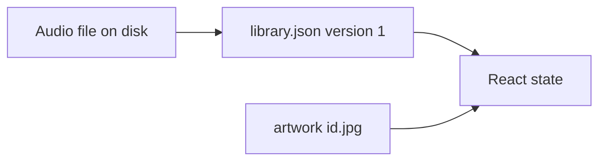
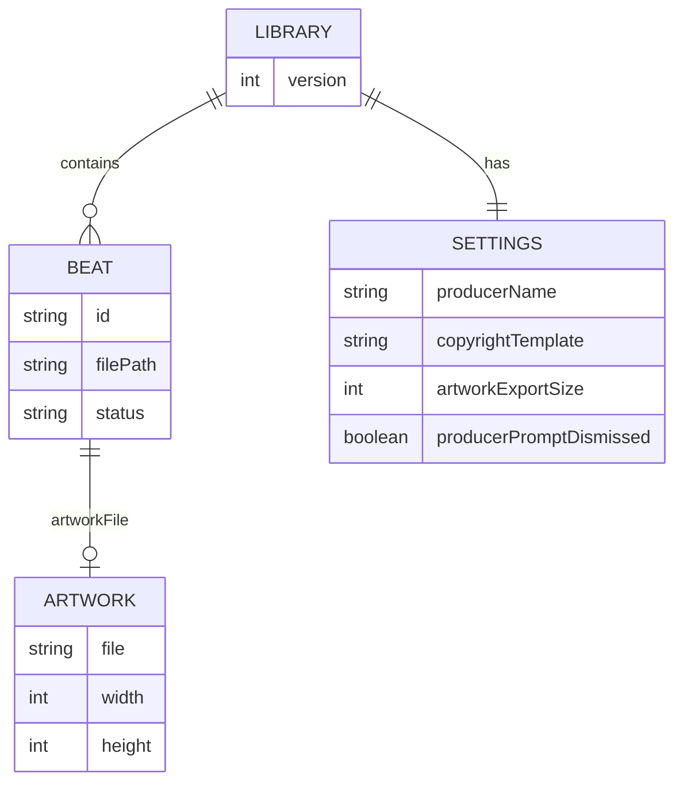

# Data schema — AwkBeats Prep Station

## Document control

| Field | Value |
| --- | --- |
| Project | AwkBeats Prep Station |
| Document title | Backend and Data Schema |
| Document ID | ABP-DATA |
| Version | 1.2 |
| Status | Final (as shipped) |
| Last updated | 2026-10-22 (UTC) |
| Author | Cursor Agent, for owner Awkward J |
| Repo | https://github.com/Awkward8787/awkbeats-prep-station |
| Branch | `cursor/awkbeats-prep-station-e2e2` |
| Commit SHA | f99d3c6a38ad256e123fa13b50e0f7660369bd61 |
| Live URL | None. Data stays on the producer machine. |
| Operator | Awkward J (legal entity UNCONFIRMED) |

## Table of contents

1. Data architecture
2. Entity diagram
3. Entities
4. Client storage
5. IPC reference
6. Third-party API calls
7. Webhooks
8. Background jobs
9. Files
10. Lifecycle
11. Migrations and seeding
12. Security of data
13. Glossary
14. Open questions
15. Changelog
16. Sources

## 1. Data architecture

There is no database server. Three places hold data:

| Data | Where |
| --- | --- |
| Catalog and settings | `library.json` in the Electron userData directory |
| Cover images | `userData/artwork/<beat id>.jpg` |
| Audio | The path the producer imported. Not copied. |
| UI state (selection, filters, sort) | React memory. Lost on quit. |

Caption: The JSON catalog points at audio paths and at artwork files. The window's filters are not persisted.

Override userData with `AWKBEATS_USER_DATA`. The default path is Electron's for this app id (`com.awkbeats.prepstation`).

## 2. Entity diagram

Caption: One library file holds many beats and one settings object. Artwork is a sibling file, not a row inside the JSON.

## 3. Entities

`missing` is computed on read (`fs.existsSync`) and is not a reason to treat the file as a second source of truth. It is still present on the TypeScript type. `LibraryStore.save` writes the in-memory beats, which include whatever `missing` value they had when loaded. Callers should treat `missing` from `list()` as live and the stored boolean as stale. That is a known quirk (debt, low): the next save can persist the previous `missing` flag. `list()` overwrites it before return.

### LibraryFile

| Field | Type | Nullable | Default | Constraints | Description | Example | PII |
| --- | --- | --- | --- | --- | --- | --- | --- |
| version | number | no | 1 | must be 1 or load throws | Schema version | 1 | no |
| beats | Beat[] | no | [] | array | Catalog | [] | mixed |
| settings | Settings | no | DEFAULT_SETTINGS | object | App settings | see below | no |

### Settings

| Field | Type | Nullable | Default | Constraints | Description | Example | PII |
| --- | --- | --- | --- | --- | --- | --- | --- |
| producerName | string | no | empty | max 200 | Saved on this computer. Pre-fills `Beat.producer` on import when the file has no producer tag. A beat can override it. Empty is a valid saved value. | Nova Beats | name |
| copyrightTemplate | string | no | © {year} {producer} | `{year}` and `{producer}` replaced at import | Used only when the file has no copyright tag and the producer name is not empty. An empty producer leaves copyright blank. | © 2026 Nova Beats | no |
| artworkExportSize | 1500 or 3000 | no | 3000 | only those two accepted in `updateSettings` | Default crop export | 3000 | no |
| producerPromptDismissed | boolean | no | false | boolean | True after the first-launch producer sheet is saved or dismissed. | false | no |

### Beat

Implemented in `src/core/library/types.ts`. `id` is `crypto.randomUUID()` from `BeatRecord.create`.

| Field | Type | Nullable | Default | Constraints | Description | Example | PII |
| --- | --- | --- | --- | --- | --- | --- | --- |
| id | string | no | uuid | unique in practice | Primary id | a uuid | no |
| filePath | string | no | — | unique per library (`findByPath`) | Absolute audio path | /Users/me/beats/Night Drive.wav | path may contain a username |
| fileName | string | no | basename | — | Display name | Night Drive.wav | no |
| format | wav, mp3, aiff, flac | no | — | enum | Container | wav | no |
| fileSize | number | no | stat size | bytes, import max 2 GiB | Size | 1440004 | no |
| durationSec | number | yes | null | seconds | Duration | 8.0 | no |
| sampleRate | number | yes | null | Hz | Rate | 44100 | no |
| title | string | no | tag or basename | — | Title | Night Drive | no |
| producer | string | no | file tag, else producerName | max 200 on update | Per-beat producer. Empty when neither the file nor the setting has a name. | Nova Beats | name |
| artist | string | no | file tag, else empty | max 200 on update | Performing artist. Not copied from the producer name. | Lina Cole | name |
| genre | string | no | "" | free text, suggestions in `BeatCatalog.genres` | Genre | Trap | no |
| mood | string | no | "" | suggestions in `BeatCatalog.moods` | Mood | Dark | no |
| tags | string[] | no | [] | max 24, each max 32, case-insensitive unique | Tags | night, keys | no |
| comment | string | no | "" | max 4000 on update | Comment | — | could be personal |
| copyright | string | no | blank, or template when a producer name exists | max 400 on update | Copyright line. Blank when the file has no copyright tag and the producer name is empty. | © 2026 Nova Beats | no |
| isrc | string | no | "" | empty or 12-char canonical | ISRC | USAWK2600001 | no |
| date | string | no | tag or mtime | stored as YYYY-MM-DD slice | Date | 2026-10-21 | no |
| bpmDetected | number | yes | null | 0.01 resolution when set | Detector BPM | 140.25 | no |
| bpmScale | 0.5, 1, or 2 | no | 1 | enum | Half or double | 1 | no |
| bpmOverride | number | yes | null | 40–300 if set | Hand BPM | null | no |
| bpmLocked | boolean | no | false | — | Lock | false | no |
| bpmConfidence | number | yes | null | 0–1 | Detector confidence | 0.98 | no |
| keyDetected | string | yes | null | Camelot name | Detected key | F# minor | no |
| camelotDetected | string | yes | null | like 11A | Detected code | 11A | no |
| keyOverride | string | yes | null | — | Hand key | null | no |
| camelotOverride | string | yes | null | — | Hand code | null | no |
| keyLocked | boolean | no | false | — | Lock | false | no |
| keyConfidence | number | yes | null | 0–1 | Gap score | 1 | no |
| status | BeatStatus | no | idea | idea, in_progress, ready, leased, sold | Catalog status | ready | no |
| notes | string | no | "" | — | Internal notes, not written to the audio tag. Editing notes does not set `tagsDirty`. | Hold for Friday | could be personal |
| tagsDirty | boolean | no | false | missing values load as false | True after a change that Write tags to file would store in the audio. Cleared after a successful write. Status-only edits do not set it. | false | no |
| artworkFile | string | yes | null | filename only | Cover filename | `<id>.jpg` | no |
| artworkWidth | number | yes | null | pixels | Width | 1800 | no |
| artworkHeight | number | yes | null | pixels | Height | 2400 | no |
| peaks | number[] | no | [] | 160 values, 3 decimals, 0–1 | Waveform | 0.12 | no |
| missing | boolean | no | false | recomputed on read | File absent | false | no |
| analyzedAt | string | yes | null | ISO timestamp | Last analysis | 2026-10-21T00:00:00.000Z | no |
| createdAt | string | no | now | ISO | Created | same | no |
| updatedAt | string | no | now | ISO | Updated | same | no |
| importedAt | string | no | now | ISO | Imported | same | no |

### Enums

Beat status labels (`BeatStatusLabel`): Idea, In progress, Ready, Leased, Sold.

Genre suggestions: Trap, Drill, Hip-Hop, R&B, Pop, Afrobeats, Amapiano, Jersey Club, House, Techno, Boom Bap, Lo-fi, Rage, Dancehall, Reggaeton. The field accepts other strings.

Mood suggestions: Dark, Energetic, Chill, Melodic, Aggressive, Sad, Bouncy, Soulful, Spacey, Uplifting.

Key names come from `Camelot.roots`: C, C#, D, D#, E, F, F#, G, G#, A, A#, B, plus `major` or `minor`. Flats parse onto the sharp spelling (`Eb major` is `D# major`).

### Tag payload written into audio

`TagCommit.fromBeat` maps the working BPM and working key. `producer` is `beat.producer` (the per-beat value, which import pre-filled from settings). `artist` is `beat.artist`. ID3 frames (`TagWriter.id3Tags`), written into MP3 and into the ID3 chunk of WAV and AIFF:

| App field | ID3 | Vorbis | Notes |
| --- | --- | --- | --- |
| title | TIT2 | TITLE | |
| artist | TPE1 | ARTIST | Performing artist. Empty stays empty. |
| producer | TCOM, TIPL (`producer` + NUL + name), TXXX PRODUCER | COMPOSER and PRODUCER | Per-beat producer name |
| genre | TCON | GENRE | |
| comment | COMM eng | COMMENT | |
| bpm | TBPM with two decimals | BPM | |
| key | TKEY up to 3 chars (`F#m`) plus TXXX KEY | KEY and INITIALKEY (Camelot) | TKEY cannot hold "F# minor" |
| camelot | TXXX CAMELOT | CAMELOT | |
| tags | TXXX TAGS, comma-separated | TAGS | |
| mood | TXXX MOOD | MOOD | |
| copyright | TCOP if it can be made to start with a year, plus TXXX COPYRIGHT | COPYRIGHT | `TagText.copyrightFrame` |
| isrc | TSRC | ISRC | |
| date | TDRL and TYER when the first four chars are a year | DATE | |
| artwork | APIC type 3 | PICTURE type 3 | |

WAV also writes RIFF LIST/INFO: INAM title, IART artist, IPRO producer, IGNR, ICMT, ICRD, ICOP, ISBJ. IPRO is the INFO field this app uses for the producer name. The same WAV also gets an ID3 chunk with TPE1, TCOM, TIPL, and TXXX:PRODUCER. Existing INFO and `id3 ` chunks are replaced. Other RIFF chunks, including `data`, stay. AIFF writes NAME, AUTH (artist), ANNO, and the same ID3 chunk. FLAC Vorbis comments use ARTIST, PRODUCER, and COMPOSER.

M4A / MP4 is not an import or export format, so no `©ART` or iTunes producer atom is written.

CSV and the library JSON both store the two names. `library.json` is the catalog JSON: each beat has `producer` and `artist`, and `settings.producerName` is the default. There is no second JSON export.

FLAC keeps STREAMINFO and audio frames, drops old VORBIS_COMMENT (type 4), PICTURE (type 6), and PADDING (type 1), then writes a new comment, an optional picture, and 256 bytes of padding. Vendor string: `AwkBeats Prep Station`.

### CSV columns

`CsvExport.headers`: id, title, producer, artist, file_name, file_path, format, duration_sec, bpm, bpm_detected, bpm_scale, bpm_override, bpm_locked, key, camelot, key_detected, camelot_detected, key_locked, key_confidence, genre, mood, tags (joined with `|`), status, notes, comment, copyright, isrc, date, analyzed_at, imported_at, updated_at. RFC 4180 quoting.

## 4. Client-side storage

localStorage, sessionStorage, IndexedDB, and cookies are not used.

The only persisted client state is `library.json` and the artwork directory, written by the main process. Shape: `LibraryFile` above. Version strategy: `load()` throws if `version !== 1`. There is no migrator yet. Size: one JSON rewrite of the full catalog per change. Cleared by deleting the userData folder, or by Remove for individual beats (artwork file deleted, audio kept).

## 5. IPC reference

These are not HTTP endpoints. They are `ipcMain.handle` channels. Auth is the local user. No rate limit. The preload method is the name in `PrepApi`.

| ID | Channel | Preload | Purpose | Payload | Success | Error | Side effects | File |
| --- | --- | --- | --- | --- | --- | --- | --- | --- |
| API-001 | library:list | list | All beats | none | Beat[] | throw on bad JSON at load | recomputes missing | main.ts |
| API-002 | settings:get | settings | Read settings | none | Settings | — | none | main.ts |
| API-003 | settings:update | updateSettings | Patch settings | Partial Settings | Settings | ignores illegal export size | writes JSON | LibraryStore |
| API-004 | library:import | importPaths | Import | string[] paths | ImportResult | per-file messages inside result | writes JSON, may write artwork | Importer |
| API-005 | dialog:audio | pickAudio | Open files | none | string[] | [] if cancelled | none | main.ts |
| API-006 | dialog:folder | pickFolder | Open folder | none | string or null | null if cancelled | none | main.ts |
| API-007 | dialog:artwork | pickArtwork | Open image | none | {name, bytes} or null | null if cancelled | none | main.ts |
| API-008 | beat:update | updateBeat | Patch one beat | id, UserPatch | {beat} or {error} | error string, no throw for validation | writes JSON | LibraryStore |
| API-009 | beat:batch | batchUpdate | Patch many | ids, BatchPatch | Beat[] | — | writes JSON | LibraryStore |
| API-010 | beat:remove | remove | Remove rows | ids | Beat[] | — | deletes artwork files, writes JSON | LibraryStore |
| API-011 | beat:analyze | analyze | Analyze WAV/AIFF | ids | {beats, needsDecode, errors} | errors[] for failures | writes JSON | main.ts |
| API-012 | beat:analysis | submitAnalysis | Store renderer analysis | id, AnalysisResult | {beat} or {error} | — | writes JSON, respects locks | LibraryStore.applyAnalysis |
| API-013 | beat:audio | readAudio | Whole file bytes | id | Uint8Array | throws if missing | none | main.ts |
| API-014 | beat:write-tags | writeTags | Write audio tags | ids | {id, ok, message}[] | message on failure | mutates the audio file | TagWriter |
| API-015 | beat:artwork | saveArtwork | Store JPEG | id, bytes, width, height | Beat | — | writes jpg and JSON | LibraryStore |
| API-016 | beat:export-artwork | exportArtwork | Save dialog | id | path or null | null if none | writes a copy | main.ts |
| API-017 | library:csv | exportCsv | Save CSV | ids (empty means all) | path or null | null if cancelled | writes the CSV the user chose | CsvExport |
| API-018 | beat:reveal | showInFolder | Show in folder | id | void | — | OS shell | shell.showItemInFolder |
| API-019 | app:site | openSite | Open brand site | none | void | — | external browser | https://awkbeats.com only |
| API-020 | app:startup | takeStartup | MP3/FLAC imported via `--import` | none | string[] ids, then cleared | — | none after read | main.ts |
| API-021 | menu-command | onMenu | Menu to renderer | command string | event | — | none | main.ts |
| API-022 | beat://audio/id and beat://cover/id | audio and img src | Stream file | id in URL | file bytes | empty if unknown | none | protocol.handle |

Example `beat:update` validation error body: `{ "error": "BPM must be between 40 and 300." }`.

`--import <path>` on the executable runs import before the window loads and queues compressed ids for `app:startup`.

Idempotency: import of an existing path is a duplicate skip. Analyze overwrites unlocked analysis fields. Tag write replaces prior ID3, INFO, or Vorbis comment blocks.

## 6. Third-party API calls made by the server

Not applicable. The main process does not call a remote API. `shell.openExternal('https://awkbeats.com')` is a browser handoff, not an API call. music-metadata and node-id3 are in-process.

## 7. Webhooks

Not applicable. None incoming or outgoing.

## 8. Background jobs and scheduled tasks

Not applicable. No cron, no queue. Analysis runs on the IPC call stack (main for WAV/AIFF, renderer for MP3/FLAC). A long file is capped at 90 seconds of samples inside `TrackAnalyzer`.

## 9. File and object storage

| Path | Permissions | Contents | Cleanup |
| --- | --- | --- | --- |
| userData/library.json | user umask | Catalog | Replaced atomically via `library.json.tmp` then rename |
| userData/artwork/*.jpg | user umask | Cover | Deleted in `LibraryStore.remove` |
| Audio path on the beat | unchanged | Original audio | Never deleted by the app |
| CSV path from the save dialog | user choice | Export | Not tracked |
| Exported cover from the save dialog | user choice | JPEG copy | Not tracked |

No sweep of old files. Orphan artwork can remain if a beat id is removed from the JSON by hand. The app's remove path deletes the jpg it knows about.

## 10. Data lifecycle

Retention: until the producer deletes the files. No backup is taken by the app. Restore: copy `library.json` and `artwork/` back into userData. Audio must still be at `filePath`. If a path changed, the row shows missing; v1 has no relink dialog.

Deletion: Remove drops the row and the artwork. It does not delete audio. Uninstalling the app does not delete userData on every OS; Electron's default is to leave it. The producer deletes that folder to wipe the catalog.

## 11. Migrations and seeding

No migration runner. A future version must bump `version` and teach `load()` to upgrade. Rollback of a bad JSON is the `.tmp` file only if a crash happens before rename; after rename, the previous file is gone. Keep a copy if you experiment.

Seeding: `scripts/seed-demo.ts` is a development tool. It is not invoked by the app or by CI. It writes generated loops, tags, and a cover into a directory you pass. Do not point it at a real catalog. `tests/fixtures/silence.flac` is a 0.1 second silent FLAC used only by tests.

## 12. Security of data

No encryption at rest beyond what the operating system does for the user account. No passwords, no hashes. Access control is the OS user. The renderer cannot read `library.json` except through IPC. Tag writes require a library id, and the path written is the path stored on that beat, not a path chosen by the renderer in the write call.

`beat:audio` returns the full file. That is intended for local decode. Do not expose the preload bridge to untrusted web content. Navigation guards in `electron/main.ts` exist for that reason.

## 13. Glossary

| Term | Meaning |
| --- | --- |
| userData | Electron application data directory. |
| Working BPM | `bpmOverride` else `bpmDetected * bpmScale`. |
| TXXX | ID3 user-text frame. Used for MOOD, TAGS, KEY, CAMELOT, PRODUCER, COPYRIGHT. |
| APIC | ID3 attached picture. |

## 14. Open questions

| ID | Question | Owner | Blocked |
| --- | --- | --- | --- |
| Q-003 | Validate ISRC against a real registrant prefix? | Awkward J | Stricter than the 12-character pattern |
| Q-011 | Should notes be written into the audio comment as well? | Awkward J | v1 keeps notes only in the catalog |
| Q-012 | Relink when a file moves? | Awkward J | v1 marks the row missing |

## 15. Changelog

| Date | Version | Change | Why |
| --- | --- | --- | --- |
| 2026-10-21 | 1.0 | Schema for library version 1 and the IPC list. | Owner build brief. |
| 2026-10-22 | 1.2 | Producer and artist are separate beat fields. The producer default starts empty. | The app is for any producer. |

## 16. Sources

- `src/core/library/types.ts`, `LibraryStore.ts`, `CsvExport.ts`, `Importer.ts`, `AudioFiles.ts`, `BeatRules.ts`.
- `src/core/tags/TagWriter.ts`, `TagCommit.ts`, `TagTypes.ts`, `TagReader.ts`.
- `electron/main.ts`, `electron/preload.ts`.
