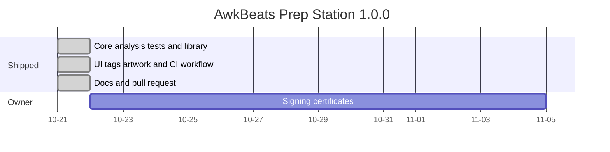

# Implementation plan — AwkBeats Prep Station

## Document control

| Field | Value |
| --- | --- |
| Project | AwkBeats Prep Station |
| Document title | Implementation Plan |
| Document ID | ABP-PLAN |
| Version | 1.1 |
| Status | Final (as shipped) |
| Last updated | 2026-10-21 (UTC) |
| Author | Cursor Agent, for owner Awkward J |
| Repo | https://github.com/Awkward8787/awkbeats-prep-station |
| Branch | `cursor/awkbeats-prep-station-e2e2` |
| Commit SHA | f99d3c6a38ad256e123fa13b50e0f7660369bd61 |
| Live URL | None. Installers are GitHub Actions artifacts, not a Release. |
| Operator | Awkward J (legal entity UNCONFIRMED) |

## Table of contents

1. Delivery summary
2. Phases
3. Work breakdown
4. Review gates
5. Testing and QA
6. Launch checklist
7. Deployment runbook
8. Post-launch and owner actions
9. Roadmap
10. Risks
11. Maintenance
12. Glossary
13. Open questions
14. Changelog
15. Sources

## 1. Delivery summary

AwkBeats Prep Station 1.0.0 was built in this repository as a local Electron app: library, offline BPM and key analysis, tag writing, cover art, CSV, batch tools, tests, and a GitHub Actions workflow that builds an unsigned macOS dmg and a Windows exe. Branch pushes keep those installers as workflow artifacts. A `v*` tag publishes them on the GitHub Releases page. The builder was Cursor Agent. The owner is Awkward J.

## 2. Phases and milestones

Dates are the day the tree was produced (2026-10-21). They are not estimates of future work.

Caption: The build landed in one working tree. The signing bar is the owner's, and the two weeks on the chart are a placeholder span, not a promise.

| Phase | Status | Result |
| --- | --- | --- |
| Analysis, library, tags, tests | Shipped | `src/core`, `tests/` |
| UI and installers workflow | Shipped | `src/renderer`, `.github/workflows/installers.yml` |
| Documentation and PDFs | Shipped | `docs/` |
| Signed release | Planned | Blocked on certificates. Not started. |

## 3. Work breakdown

| ID | Task | Phase | Requirements | Status | Notes |
| --- | --- | --- | --- | --- | --- |
| TASK-001 | Original BPM and key detectors, no GPL library | Build | FR-004, FR-005, NFR-001 | Shipped | `src/core/analysis` |
| TASK-002 | Reference-tone tests at 0.01 BPM and 24 keys | Build | NFR-002 | Shipped | `tests/bpm-key.test.ts` |
| TASK-003 | Library JSON, import, filters, CSV, locks | Build | FR-001–FR-003, FR-006, FR-011, FR-012 | Shipped | `src/core/library` |
| TASK-004 | ID3, RIFF INFO, Vorbis, artwork embed | Build | FR-008, FR-009 | Shipped | `TagWriter.ts` |
| TASK-005 | Dark UI, batch, crop, shortcuts | Build | FR-007, FR-013–FR-017, NFR-004 | Shipped | `src/renderer` |
| TASK-006 | License check in CI | Build | NFR-001 | Shipped | `scripts/check-licenses.mjs` |
| TASK-007 | Actions workflow for dmg and exe | Build | NFR-003 | Shipped | artifacts, `--publish never` |
| TASK-008 | Contrast fix for faint text | Build | NFR-008 | Shipped | `--text-faint` `#938d85` |
| TASK-009 | Six docs and PDFs | Docs | — | Shipped | this folder |
| TASK-010 | Apple notarization | Owner | NFR-003 follow-up | Planned | Secrets in README |
| TASK-011 | Windows Authenticode | Owner | NFR-003 follow-up | Planned | EV recommended |
| TASK-012 | Confirm legal entity and license | Owner | Q-001, Q-002 | Planned | LICENSE is proprietary pending confirmation |
| TASK-013 | Use the iOS app icon and transparent logo | Owner | Q-004 | Shipped | `build/icon.png`, `build/logo.png`. AJ svg removed |
| TASK-014 | Publish installers only from a `v*` tag | Build | brief | Shipped | `publish: null` on the builder. `.github/workflows/release.yml` attaches files with `GITHUB_TOKEN` |

The pull request that contains this file is the delivery PR into `main`. Commit SHAs are on that branch.

## 4. Review gates

| Review | Date | Verdict | Findings | Resolution |
| --- | --- | --- | --- | --- |
| Unit tests | 2026-10-21 | Pass required before commit | BPM and tag assertions kept strict | Shipped with the tests green |
| License scan | 2026-10-21 | Pass | Production tree had no GPL-family license | `npm run licenses` |
| Typecheck | 2026-10-21 | Pass | `tsc --noEmit` | Shipped |
| Contrast | 2026-10-21 | Fail, then pass | `#7e786e` was 4.02:1 on elevated surfaces | Changed to `#938d85`, minimum 4.50:1 |
| External code review, accessibility audit, security audit | — | Not run | No third-party report was attached to the brief | Deferred. Debt is listed in ABP-TRD. |
| UI check on Electron | 2026-10-21 | Exercised | Library, analysis card, metadata, crop dialog captured | Screenshots are PR artifacts |

No finding was waived by weakening a test.

## 5. Testing and QA

Automated: `npm test`, `npm run typecheck`, `npm run licenses`. What each test file covers is listed in ABP-TRD section 13.

Manual script used on the Linux Electron build:

1. Launch with `AWKBEATS_USER_DATA` pointed at a scratch directory.
2. Import four generated loops (WAV). Confirm the table lists them.
3. Select the 140.25 BPM F# minor loop. Confirm the inspector shows 140.25, F# minor, and a Camelot badge.
4. Scroll to cover, title, producer, genre, mood, and tags.
5. Open Adjust crop. Confirm the export size control offers 3000×3000.
6. Half-time and double-time are unit-tested (`BpmMath.half(140.25)` is 70.13, and the scale is always applied to the detected tempo). The buttons call `save({ bpmScale: 0.5 | 2, bpmOverride: null })`.

Devices: development GUI on Linux with Electron 33.4.11. macOS and Windows are covered by the installer jobs compiling, not by a human clicking the packaged app in this session. Browsers: not applicable.

Results: unit tests and typecheck passed on the shipping tree. Installer artifact names are confirmed when the Actions run for this commit is green. If that run fails, the fix lands on the same branch before the PR is treated as done.

## 6. Launch checklist

| Item | State | Evidence |
| --- | --- | --- |
| Domain and DNS for the app | Not applicable | No app host. awkbeats.com is the brand site and is not changed by this repo. |
| SSL for the app | Not applicable | Local app |
| Secrets for unsigned build | Done | None required |
| Signing secrets | Not done | Owner |
| Payments | Not applicable | No provider |
| Legal pages inside the app | Not done | Not in scope for v1. Sale terms are Q-005. |
| Analytics | Done as none | No SDK |
| CSP | Done | `src/renderer/index.html` |
| 404 page | Not applicable | No router |
| App icon | Done | `build/icon.png`, `build/icon.ico` |
| Performance | Done as measured | ABP-TRD section 9 |
| Accessibility contrast | Done | ABP-DESIGN section 3 |
| Backups | Not done by the app | Producer copies userData |
| Monitoring | Not applicable | No service |
| Installers | Workflow shipped | Artifact upload steps |
| Release published | Not done, on purpose | `--publish never` |

## 7. Deployment runbook

There is no server deploy.

To produce installers from a desktop:

1. Install Node 22.
2. `npm ci`
3. On a Mac: `npm run dist:mac`. On Windows: `npm run dist:win`.
4. Take the files in `release/`. Do not run electron-builder publish.

From GitHub:

1. Push the branch. Workflow `Build installers` starts on every push.
2. Open the run. Download `AwkBeats-Prep-Station-macOS` and `AwkBeats-Prep-Station-Windows`.
3. Expected names: `AwkBeats-Prep-Station-1.0.0-mac-arm64.dmg`, `AwkBeats-Prep-Station-1.0.0-mac-x64.dmg`, `AwkBeats-Prep-Station-1.0.0-win-x64.exe`.

Verify: tests job green, both artifact jobs green, files non-empty. Rollback: download the previous run's artifacts. Access: whoever can push to the repo can start a build. Signing secrets, once added, should be environment secrets limited to maintainers.

Do not create a GitHub Release from this workflow.

## 8. Post-launch and owner actions

No temporary files need deleting in the repo. `dist/` and `release/` are gitignored.

Owner actions, in order:

1. **Apple signing and notarization.** Enroll the legal entity in the Apple Developer Program. Create a Developer ID Application certificate. Export the `.p12`. Create an App Store Connect API key. Add GitHub secrets `CSC_LINK` (base64 p12), `CSC_KEY_PASSWORD`, `APPLE_API_KEY` (base64 p8), `APPLE_API_KEY_ID`, `APPLE_API_ISSUER`, `APPLE_TEAM_ID`. Then set `mac.identity`, `hardenedRuntime: true`, and notarization in `electron-builder.yml`. Details are in the README.
2. **Windows code signing.** Buy an OV or EV certificate. EV is what SmartScreen trusts without a reputation warmup. Add `WIN_CSC_LINK` and `WIN_CSC_KEY_PASSWORD` (or `CSC_LINK` / `CSC_KEY_PASSWORD`). `signAndEditExecutable` is already true.
3. **Confirm the legal entity** for the copyright string. The app currently says Awkward J. Q-001.
4. **Confirm the license.** The repo ships `LICENSE` as all rights reserved because the app may be sold. Say if that should change. Q-002.
5. **ISRC.** The check is 12 characters. Provide a registrant prefix only if you want a tighter check. Q-003.
6. **Brand.** Done. The iOS icon is the installer art. The transparent logo is the in-app mark. Q-004.
7. **Distribution.** Decide where installers are downloaded. Do not use a GitHub Release until you ask for one. This delivery does not publish one.
8. **Support email.** None is shown. Send one if it should appear. Q-006.

## 9. Roadmap and next phases

| ID | Task | Requirements | Depends on | Status | Size |
| --- | --- | --- | --- | --- | --- |
| TASK-010 | Signed macOS build | NFR-003 | Q-001, Apple secrets | Planned | One workflow change after secrets exist |
| TASK-011 | Signed Windows build | NFR-003 | Certificate | Planned | Same |
| TASK-015 | Relink missing files | FR-020 | Q-012 | Planned | Small dialog |
| TASK-016 | Optional image watermark | FR-010 | Owner asks | Deferred | Not in v1 |
| TASK-017 | SQLite catalog | — | Catalog growth | Deferred | New store behind `LibraryStore` |
| TASK-018 | Linux package | — | Owner asks | Deferred | electron-builder linux target |
| TASK-019 | Focus trap on dialogs | NFR-007 | — | Planned | `dialogs.tsx` |
| TASK-020 | Price and storefront | Monetization | Q-005 | Deferred | No number was given. Do not invent one. |

"Size" is structural, not a schedule.

## 10. Risks and mitigations

| Risk | Mitigation |
| --- | --- |
| CI cannot sign, so the first artifacts warn on open | Documented. Unsigned is the accepted v1 state. |
| A future contributor adds essentia or another GPL detector | `npm run licenses` fails the test job |
| Detector wrong on a dense mix | Override, lock, half-time, double-time. Tests stay strict on generated material. |
| `GITHUB_TOKEN` tempts electron-builder to publish | `publish: null` and `--publish never`. Only `.github/workflows/release.yml` creates a Release, and only for an existing `v*` tag |

## 11. Maintenance plan

- Dependencies: review npm updates when touching the app. Re-run tests and `npm run licenses` after any audio or tag dependency bump. Do not upgrade music-metadata past a major version without re-checking decimal BPM, because 7.14.0's common reader drops the fraction and `TagReader.readNative` compensates.
- Secrets: only exist once the owner adds them. Rotate by replacing the GitHub secret and revoking the old certificate or API key at the vendor. No rotation is due today.
- Certificates: Apple and Windows certs expire on the vendor's calendar. Renew before the signed job starts failing.
- Content: genre and mood lists are in `BeatCatalog`. UI strings are in `UserMessage.ts` and the components.
- Cadence: re-run the installer workflow on each push. No separate staging cron.
- Docs: bump the document version and regenerate `docs/pdf` when behavior changes.

## 12. Glossary

| Term | Meaning |
| --- | --- |
| Artifact | A file uploaded by GitHub Actions, downloaded from the workflow run. Not a GitHub Release. |
| Developer ID | Apple certificate for apps distributed outside the Mac App Store. |
| EV certificate | Extended Validation code-signing certificate for Windows. |

## 13. Open questions

The open questions from the other documents apply here. The ones that block owner work:

| ID | Question | Owner | Blocked |
| --- | --- | --- | --- |
| Q-001 | Legal entity | Awkward J | Apple certificate name |
| Q-002 | Keep the proprietary license? | Awkward J | LICENSE |
| Q-003 | ISRC prefix | Awkward J | Tighter validation |
| Q-004 | Resolved. iOS icon and transparent logo are in `build/` | Awkward J | None |
| Q-005 | Sell or not, price, store | Awkward J | Monetization. No price in the brief. |
| Q-006 | Support email | Awkward J | Footer or About |
| Q-007 | OV or EV Windows certificate | Awkward J | SmartScreen |
| Q-009 | Should remove ever delete audio? | Awkward J | A second confirm. Default remains no. |

## 14. Changelog

| Date | Version | Change | Why |
| --- | --- | --- | --- |
| 2026-10-21 | 1.0 | Plan for the 1.0.0 delivery, including owner signing steps and an explicit decision not to publish a Release. | Owner build brief. |
| 2026-10-21 | 1.1 | TASK-013 shipped. The AJ svg is removed. | Owner supplied the iOS icon and transparent logo. |

## 15. Sources

- `.github/workflows/installers.yml`, `electron-builder.yml`, `README.md`, `LICENSE`.
- `package.json` scripts `dist:mac`, `dist:win`, `licenses`, `test`.
- ABP-PRD, ABP-TRD, ABP-FLOW, ABP-DESIGN, ABP-DATA in this folder.
- Owner brief: desktop app, permissive analysis license, dmg and exe artifacts, no release publish.
